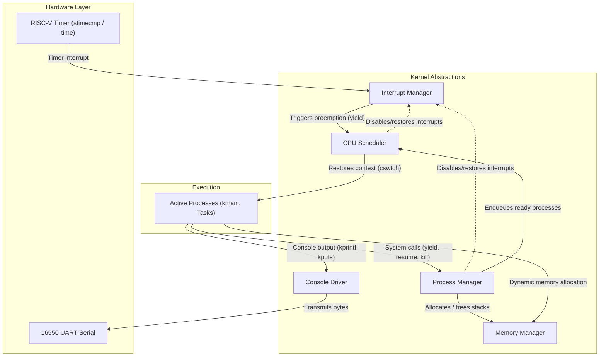

# RIO

An operating system for the RISC-V architecture.

Using the following textbooks as guides: 

* "Operating System Design: The Xinu Approach" by Douglar Comer, my
professor for CS354: Operating Systems at Purdue University.

* "xv6: a simple, Unix-like teaching operating system" by Russ Cox, Frans
Kaashoek, and Rober Morris.

## Installation (Arch Linux)

To compile and run RIO on Arch Linux, install the RISC-V bare-metal toolchain, 
GNU Make, and QEMU:

```bash
sudo pacman -S base-devel riscv64-elf-gcc riscv64-elf-binutils qemu-system-riscv
```

Package details:
- `base-devel`: Provides GNU `make` and essential compilation utilities.
- `riscv64-elf-gcc`: GCC cross-compiler targeting 64-bit bare-metal RISC-V
- `riscv64-elf-binutils`: Assembler and binary utilities for RISC-V 
(`riscv64-elf-as`).
- `qemu-system-riscv`: QEMU system emulator for RISC-V, providing
`qemu-system-riscv64`.

## Makefile Guide

The provided Makefile contains three primary targets:

- `make` or `make build`:
Build the operating system binary into a file called `rio.elf`.

```bash
make build
```

- `make run`:
Runs the compiled kernel binary (`rio.elf`) inside QEMU using the RISC-V virt
machine with direct serial console output.

```bash
make run
```

To exit QEMU, press `Ctrl+A` followed by `X`.

- `make clean`:
Deletes all generated binary files

```bash
make clean
```

## Project Structure

```text
rio/
├── bin/                       # Output directory for compiled object files (.o)
├── include/                   # Kernel header files
│   ├── clock.h                # Hardware clock definitions and quantum constant
│   ├── hardwaredef.h          # RISC-V hardware definitions and register context
│   ├── interrupt.h            # Interrupt definitions, IRQ codes, and mask functions (save/restore)
│   ├── kmain.h                # Initial main process function prototype
│   ├── kprint.h               # Header declarations for kernel printing functions
│   ├── ktypes.h               # Kernel type definitions, limits, and status codes
│   ├── memory.h               # Memory block and heap allocator definitions and prototypes
│   ├── process.h              # Process table structures, states, and prototypes
│   ├── rio.h                  # Master header aggregating all project headers and common declarations
│   ├── schedqueue.h           # Scheduler ready queue definitions and prototypes
│   └── scheduler.h            # Scheduler declarations and context switch interface
├── src/                       # Kernel assembly and C source files
│   ├── boot.s                 # Assembly startup code
│   ├── clock.c                # Hardware clock initialization (clock_init)
│   ├── cswtch.s               # Assembly context switch routine
│   ├── firstrunwrapper.s      # Assembly wrapper for newly created processes
│   ├── interrupt.c            # Interrupt initialization, handler table, and dispatch logic
│   ├── interruptdispatcher.s  # Assembly interrupt entry point and register save/restore
│   ├── kernel.c               # Kernel entry point (__kentry) and null process loop
│   ├── kmain.c                # Initial main process logic (kmain)
│   ├── kprint.c               # Kernel printing functions and UART communication
│   ├── memory.c               # Memory block allocation for process stacks and heap, and simple heap allocator (chef_malloc)
│   ├── process.c              # Process management (create, resume, kill) and process table
│   ├── schedqueue.c           # Scheduler ready queue operations (enqueue, dequeue, remove)
│   └── scheduler.c            # Process scheduler implementation (yield)
├── compile_flags.txt          # Compiler flags for clangd and language servers
├── LICENSE                    # GNU General Public License v3
├── linker.ld                  # Linker script mapping sections to the RAM base address
├── Makefile                   # Build rules and QEMU execution targets
└── README.md                  # Project documentation and setup instructions
```

## System Architecture

The following flowchart illustrates how RIO's core OS abstractions interact with each other:


