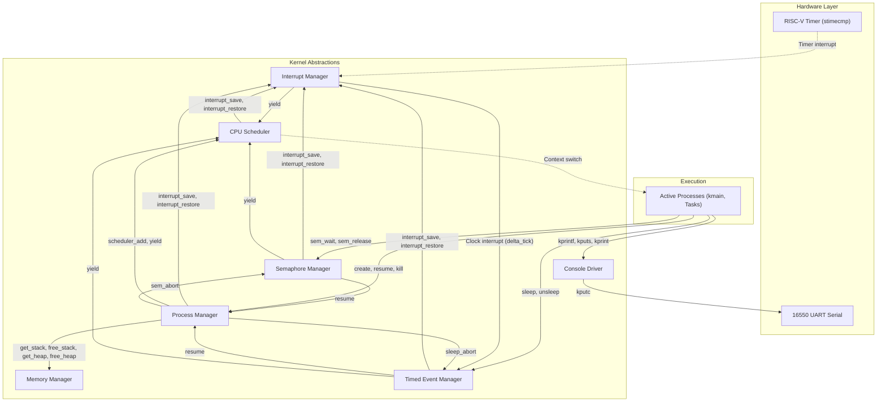

# RIO

An operating system for the RISC-V architecture, written in C23.

Using the following textbooks as guides: 

* "Operating System Design: The Xinu Approach" by Douglar Comer, my
professor for CS354: Operating Systems at Purdue University.

* "xv6: a simple, Unix-like teaching operating system" by Russ Cox, Frans
Kaashoek, and Rober Morris.

## Table of Contents

- [Installation](#installation)
  - [Option 1: Docker / Podman (Recommended, OS-Agnostic)](#option-1-docker--podman-recommended-os-agnostic)
  - [Option 2: Native Installation (Arch Linux)](#option-2-native-installation-arch-linux)
- [Makefile Guide](#makefile-guide)
- [System Architecture](#system-architecture)

## Installation

### Option 1: Docker / Podman (Recommended, OS-Agnostic)

RIO provides a minimal container environment based on `debian:stable-slim` containing the pre-configured 64-bit RISC-V cross-compilation toolchain and QEMU emulator. The `Makefile` automatically detects whether Podman or Docker is installed.

To build the container image:
```bash
make podman-image
# or with docker:
make docker-image
```

### Option 2: Native Installation (Arch Linux)

To compile and run RIO natively on Arch Linux, install the RISC-V bare-metal toolchain, 
GNU Make, and QEMU:

```bash
sudo pacman -S base-devel riscv64-elf-gcc riscv64-elf-binutils qemu-system-riscv
```

Package details:
- `base-devel`: Provides GNU `make` and essential compilation utilities.
- `riscv64-elf-gcc`: GCC cross-compiler targeting 64-bit bare-metal RISC-V.
- `riscv64-elf-binutils`: Assembler and binary utilities for RISC-V (`riscv64-elf-as`).
- `qemu-system-riscv`: QEMU system emulator for RISC-V (`qemu-system-riscv64`).

## Makefile Guide

The provided Makefile supports both native and containerized development (auto-detecting `podman` or `docker`). Any native target can be run inside a container via `podman-<target>` or `docker-<target>`:

- **Build kernel binary** (`rio.elf`):
  ```bash
  make build          # Container: make podman-build / make docker-build
  ```

- **Run in QEMU**:
  Runs the compiled kernel binary (`rio.elf`) inside QEMU using the RISC-V virt machine with direct serial console output. Press `Ctrl+A` followed by `X` to exit.
  ```bash
  make run            # Container interactive shell: make podman-run
  ```

- **Run test suite** (`rio-test.elf`):
  Builds and runs the bare-metal test suite headlessly in QEMU, self-terminating via the SiFive test finisher device upon completion.
  ```bash
  make test           # Container: make podman-test / make docker-test
  make test-build     # Compile test binary without running
  ```

- **Clean build artifacts**:
  Deletes compiled binaries (`rio.elf`, `rio-test.elf`) and object files in `bin/` while preserving directory tracking.
  ```bash
  make clean          # Container: make podman-clean / make docker-clean
  ```

- **Build container image**:
  Builds the minimal Debian-based container image (`rio`):
  ```bash
  make podman-image   # or: make docker-image
  ```

## System Architecture

The following flowchart illustrates how RIO's core OS abstractions interact with each other (see [Subsystems.md](Subsystems.md) for detailed public API endpoints and subsystem documentation):


