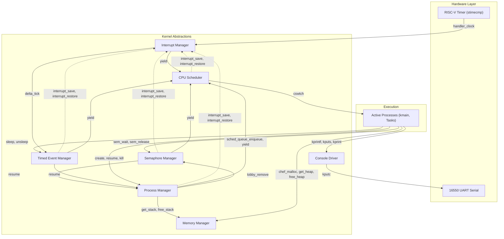

# RIO

An operating system for the RISC-V architecture.

Using the following textbooks as guides: 

* "Operating System Design: The Xinu Approach" by Douglar Comer, my
professor for CS354: Operating Systems at Purdue University.

* "xv6: a simple, Unix-like teaching operating system" by Russ Cox, Frans
Kaashoek, and Rober Morris.

## Installation (Arch Linux)

To compile and run RIO on Arch Linux, install the RISC-V bare-metal toolchain, 
GNU Make, and QEMU:

```bash
sudo pacman -S base-devel riscv64-elf-gcc riscv64-elf-binutils qemu-system-riscv
```

Package details:
- `base-devel`: Provides GNU `make` and essential compilation utilities.
- `riscv64-elf-gcc`: GCC cross-compiler targeting 64-bit bare-metal RISC-V
- `riscv64-elf-binutils`: Assembler and binary utilities for RISC-V 
(`riscv64-elf-as`).
- `qemu-system-riscv`: QEMU system emulator for RISC-V, providing
`qemu-system-riscv64`.

## Makefile Guide

The provided Makefile contains three primary targets:

- `make` or `make build`:
Build the operating system binary into a file called `rio.elf`.

```bash
make build
```

- `make run`:
Runs the compiled kernel binary (`rio.elf`) inside QEMU using the RISC-V virt
machine with direct serial console output.

```bash
make run
```

To exit QEMU, press `Ctrl+A` followed by `X`.

- `make clean`:
Deletes all generated binary files

```bash
make clean
```

## Project Structure

```text
rio/
├── bin/                       # Output directory for compiled object files (.o)
├── include/                   # Kernel header files
│   ├── clock.h                # Hardware clock definitions and quantum constant
│   ├── delta.h                # Delta list definitions and tick handler prototype
│   ├── hardwaredef.h          # RISC-V hardware definitions and register context
│   ├── interrupt.h            # Interrupt definitions, IRQ codes, and mask functions (save/restore)
│   ├── kmain.h                # Initial main process function prototype
│   ├── kprint.h               # Header declarations for kernel printing functions
│   ├── ktypes.h               # Kernel type definitions, limits, and status codes
│   ├── lobby.h                # Generic process wait queue (lobby) structures and prototypes
│   ├── memory.h               # Memory block and heap allocator definitions and prototypes
│   ├── process.h              # Process table structures, states, and prototypes
│   ├── rio.h                  # Master header aggregating all project headers and common declarations
│   ├── schedqueue.h           # Scheduler ready queue definitions and prototypes
│   ├── scheduler.h            # Scheduler declarations and context switch interface
│   ├── semaphore.h            # Semaphore structures, state definitions, and prototypes
│   └── sleep.h                # Sleep and unsleep system call prototypes
├── src/                       # Kernel assembly and C source files
│   ├── boot.s                 # Assembly startup code
│   ├── clock.c                # Hardware clock initialization (clock_init)
│   ├── cswtch.s               # Assembly context switch routine
│   ├── delta.c                # Delta list initialization and per-tick countdown handler (delta_tick)
│   ├── firstrunwrapper.s      # Assembly wrapper for newly created processes
│   ├── interrupt.c            # Interrupt initialization, handler table, and dispatch logic
│   ├── interruptdispatcher.s  # Assembly interrupt entry point and register save/restore
│   ├── kernel.c               # Kernel entry point (__kentry) and null process loop
│   ├── kmain.c                # Initial main process logic (kmain)
│   ├── kprint.c               # Kernel printing functions and UART communication
│   ├── lobby.c                # Generic process wait queue (lobby) operations (enqueue, dequeue, remove)
│   ├── memory.c               # Memory block allocation for process stacks and heap, and simple heap allocator (chef_malloc)
│   ├── process.c              # Process management (create, resume, kill) and process table
│   ├── schedqueue.c           # Scheduler ready queue operations (enqueue, dequeue, remove)
│   ├── scheduler.c            # Process scheduler implementation (yield)
│   ├── semaphore.c            # Counting semaphore implementation (sem_create, sem_wait, sem_release, sem_free)
│   └── sleep.c                # Process sleep management (sleep, unsleep)
├── compile_flags.txt          # Compiler flags for clangd and language servers
├── LICENSE                    # GNU General Public License v3
├── linker.ld                  # Linker script mapping sections to the RAM base address
├── Makefile                   # Build rules and QEMU execution targets
└── README.md                  # Project documentation and setup instructions
```

## Modules

This section describes each subsystem shown in the architecture flowchart below, including all contributing files and the public API endpoints (functions) exposed by each subsystem.

### Memory Manager
**Files:** `include/memory.h`, `src/memory.c`

| Endpoint | Description |
| :--- | :--- |
| `byte *get_stack(void)` | Allocates a 4 KiB memory block for a process stack and returns the top address (grows downward). |
| `status_code free_stack(byte *addr)` | Deallocates a process stack block, marking its state as free (`MEM_FREE`). |
| `byte *get_heap(void)` | Allocates a 4 KiB memory block to serve as a kernel heap region (`MEM_HEAP`). |
| `status_code free_heap(byte *addr)` | Deallocates a heap memory block, returning it to the pool of free blocks. |
| `void *chef_malloc(byte *data, int32 size)` | Bump allocator allocating an 8-byte aligned chunk of `size` bytes within the given heap block. |

### Process Manager
**Files:** `include/process.h`, `src/process.c`, `src/firstrunwrapper.s`

| Endpoint | Description |
| :--- | :--- |
| `void process_table_init(void)` | Initializes all process table slots to empty states (`PROC_EMPTY`) on kernel boot. |
| `syscall create(void *fn, int32 priority, const char *name, int32 n_args, ...)` | Allocates a stack, configures initial register context and arguments, and sets up a new suspended process (`PROC_SUSP`). Returns PID or `ERR`. |
| `syscall resume(pid id)` | Transitions a process to `PROC_READY`, inserts it into the scheduler ready queue, and triggers preemption (`yield()`). |
| `syscall kill(pid id)` | Terminates a process, deallocates its stack (`free_stack`), removes it from its active queue (ready queue, semaphore lobby, or delta list), and frees its table slot. |
| `void procend(void)` | Exit hook executed by `first_run_wrapper` when a process main function returns; terminates calling process via `kill(curr_pid)`. |

### Interrupt Manager
**Files:** `include/interrupt.h`, `src/interrupt.c`, `src/interruptdispatcher.s`, `include/hardwaredef.h`

| Endpoint | Description |
| :--- | :--- |
| `void interrupts_init(void)` | Programs `stvec` to `dispatch_interrupt`, populates `interrupt_handler_table`, and enables supervisor interrupts. |
| `void dispatch_interrupt(void)` | Low-level assembly trap entry point; saves registers, calls `handle_interrupt()`, and restores context upon return. |
| `status_code handle_interrupt(void)` | C trap dispatcher; queries IRQ from `scause` and executes the handler registered in `interrupt_handler_table`. |
| `irq get_irq(void)` | Reads `scause` to map hardware trap causes to kernel IRQ codes (e.g. `IRQ_CLOCK`). |
| `status_code handler_clock(void)` | Timer interrupt handler; resets `stimecmp`, advances sleep countdowns (`delta_tick()`), and triggers `yield()` at quantum boundaries. |
| `intmask interrupt_save(void)` | Atomically disables supervisor interrupts (`sstatus.SIE`) and returns previous interrupt mask (enters critical section). |
| `void interrupt_restore(intmask mask)` | Restores supervisor interrupts to the given mask state (exits critical section). |

### CPU Scheduler
**Files:** `include/scheduler.h`, `src/scheduler.c`, `src/cswtch.s`, `include/schedqueue.h`, `src/schedqueue.c`

| Endpoint | Description |
| :--- | :--- |
| `syscall yield(void)` | Core scheduler endpoint; re-enqueues current process if still running, dequeues the highest-priority ready process, and switches context via `cswtch()`. |
| `void cswtch(struct Context *prev, struct Context *next)` | Assembly context switch routine saving callee-saved registers into `prev` and restoring them from `next`. |
| `void sched_queue_init(void)` | Initializes the ready queue head and tail sentinel nodes. |
| `status_code sched_queue_enqueue(pid id, int32 priority)` | Enqueues a process into the ready queue ordered by priority (FIFO for equal priority). |
| `status_code sched_queue_dequeue(pid *id)` | Removes and returns the highest-priority process from the ready queue. |
| `status_code sched_queue_remove(pid id)` | Removes an arbitrary process from the ready queue by PID. |
| `bool sched_queue_includes(pid id)` | Checks whether a given PID is currently in the ready queue. |
| `void sched_queue_debug(void)` | Prints the current ready queue structure and order to the console for debugging. |

### Semaphore Manager
**Files:** `include/semaphore.h`, `src/semaphore.c`, `include/lobby.h`, `src/lobby.c`

| Endpoint | Description |
| :--- | :--- |
| `void semaphore_init(void)` | Initializes all semaphore entries to free states (`SEM_FREE`). |
| `syscall sem_create(int32 count, sem *id)` | Allocates an unused semaphore initialized with `count` and returns its descriptor ID. |
| `syscall sem_wait(sem id)` | Decrements semaphore count; if negative, places calling process into the semaphore wait lobby and yields CPU. |
| `syscall sem_release(sem id)` | Increments semaphore count; if waiting processes exist, dequeues the next process from the lobby and resumes it. |
| `syscall sem_free(sem id)` | Deallocates a semaphore and unblocks/resumes all waiting processes. |
| `void lobby_init(void)` | Initializes the generic process lobby wait queue structure. |
| `status_code lobby_enqueue(struct LobbyEntry *head, pid id, int32 delta)` | Enqueues a process into a wait lobby linked list with a delta value. |
| `status_code lobby_dequeue(struct LobbyEntry *head, pid *id)` | Dequeues and returns the head process from a wait lobby. |
| `status_code lobby_peek(struct LobbyEntry *head, pid *id, int32 *delta)` | Inspects the head process ID and delta value in a lobby without removing it. |
| `status_code lobby_remove(struct LobbyEntry *head, pid id)` | Removes an arbitrary process from a lobby wait list by PID. |
| `status_code decrement_delta(struct LobbyEntry *head, pid id)` | Decrements the delta count of a queued lobby entry. |

### Timed Event Manager
**Files:** `include/delta.h`, `src/delta.c`, `include/sleep.h`, `src/sleep.c`

| Endpoint | Description |
| :--- | :--- |
| `void delta_init(void)` | Initializes the global sleep delta queue (`g_delta`). |
| `status_code delta_tick(void)` | Per-tick countdown handler; decrements remaining delta on head process, dequeues and wakes expired processes (`resume()`), and yields CPU if any were resumed. |
| `syscall sleep(uint64 ms)` | Suspends the calling process for `ms` milliseconds by inserting it into the delta list and calling `yield()`. |
| `syscall unsleep(pid id)` | Cancels a sleeping process's timer early, removing it from the delta list and calling `resume()`. |

### Console Driver
**Files:** `include/kprint.h`, `src/kprint.c`

| Endpoint | Description |
| :--- | :--- |
| `status_code kputc(char c)` | Transmits a single character to the 16550 UART serial transmitter register (`UART_ADDR`). |
| `status_code kprint(const char *str)` | Transmits a null-terminated string to UART by repeatedly calling `kputc`. |
| `status_code kputs(const char *str)` | Transmits a null-terminated string followed by a newline (`\n`) to UART. |
| `void kprintf(const char *format, ...)` | Kernel formatted printing function supporting `%d`, `%i`, `%u`, `%x`, `%p`, `%c`, and `%s`. |
| `void kvprintf(const char *format, va_list arg)` | Core variadic formatted string emitter writing directly to UART. |

### Hardware & Execution Layers
**Files:** `include/clock.h`, `src/clock.c`, `include/hardwaredef.h`, `include/kmain.h`, `src/kmain.c`

| Subsystem / Component | Files | Endpoints / Operations | Description |
| :--- | :--- | :--- | :--- |
| **RISC-V Timer (`stimecmp`)** | `include/clock.h`, `src/clock.c`, `include/hardwaredef.h` | `clock_init()`, `read_time()`, `write_stimecmp()` | Programs initial timer interrupt in `stimecmp` CSR; hardware timer CSR read/write accessors. |
| **16550 UART Serial** | `include/kprint.h` | Memory-mapped I/O (`UART_ADDR`) | Physical 16550 UART hardware chip mapped at address `0x10000000`. |
| **Active Processes** | `include/kmain.h`, `src/kmain.c` | `kmain()` | Entry point for the first kernel process (`kmain`) and subsequent user tasks. |

## System Architecture

The following flowchart illustrates how RIO's core OS abstractions interact with each other:


